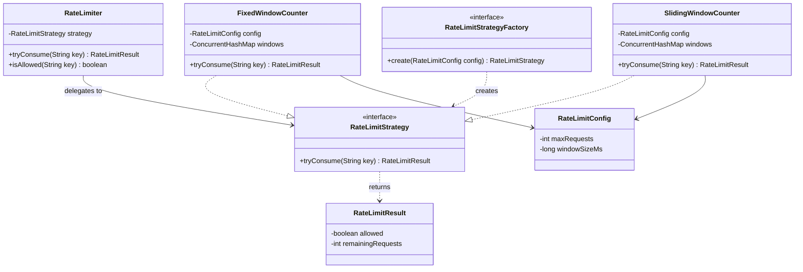

# Pluggable Rate Limiting System

Rate limits external resource calls (not incoming API requests). Only checked when business logic decides an external call is needed.

## How It Works

1. Client calls your API
2. Internal service runs business logic
3. If an external call is needed, the `RateLimiter` is consulted
4. If allowed, the external API is called. Otherwise, the request is rejected gracefully.

The rate limiting key can be anything: customer ID, tenant ID, API key, provider name.

## Project Structure

```
src/main/java/com/ratelimiter/
    Main.java                                -- Driver / demo
    RateLimiter.java                         -- Entry point for services
    model/
        RateLimitConfig.java                 -- Config (maxRequests, windowSizeMs)
        RateLimitResult.java                 -- Result (allowed, remaining)
    strategy/
        RateLimitStrategy.java               -- Algorithm interface
        FixedWindowCounter.java              -- Fixed window implementation
        SlidingWindowCounter.java            -- Sliding window implementation
    factory/
        RateLimitStrategyFactory.java        -- Creates strategy from config
```

## Class Diagram



## Design Patterns Applied

| Pattern | Where | Why |
|---------|-------|-----|
| **Strategy** | `RateLimitStrategy` with `FixedWindowCounter`, `SlidingWindowCounter` | Swap algorithms without changing business logic. OCP. |
| **Factory** | `RateLimitStrategyFactory` | Decouples strategy creation from the caller. DIP. |

## Algorithm Trade-offs

| | Fixed Window | Sliding Window |
|---|---|---|
| **How it works** | Divides time into fixed intervals, counts per interval | Weighted blend of current + previous window counts |
| **Accuracy** | Can allow 2x burst at window boundary | Smooths out boundary bursts |
| **Memory** | One counter per key per window | Two counters per key (current + previous) |
| **Complexity** | Simple | Slightly more math |
| **Best for** | Rough limiting where simplicity matters | Accurate limiting where burst control matters |

## SOLID Principles

- **SRP**: `RateLimiter` delegates to strategy. Algorithms are self-contained. Config and result are separate models.
- **OCP**: Add Token Bucket or Leaky Bucket by implementing `RateLimitStrategy`. No existing code changes.
- **LSP**: Any `RateLimitStrategy` implementation works interchangeably.
- **ISP**: `RateLimitStrategy` has a single method.
- **DIP**: `RateLimiter` depends on the `RateLimitStrategy` abstraction, not concrete classes.

## Thread Safety

- `FixedWindowCounter` uses `ConcurrentHashMap` + `AtomicInteger` for lock-free counting.
- `SlidingWindowCounter` uses `synchronized` on `tryConsume` since it reads/writes multiple fields atomically.

## Running

```bash
javac -d out src/main/java/com/ratelimiter/**/*.java src/main/java/com/ratelimiter/*.java
java -cp out com.ratelimiter.Main
```
